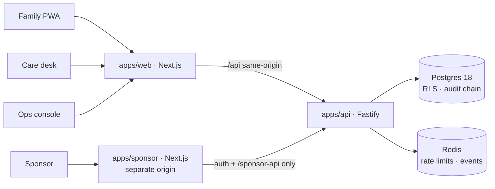

# Tomoni

**The care team between doctor visits, and a living research cohort for drug development.** Grandpa gets a short daily call in his language, his family gets one app, and his doctor gets a between-visit care program that Medicare pays for. With separate consent, the same calls build a research cohort that drug developers pay to use.

The product and business plan: [`docs/PRODUCT.md`](docs/PRODUCT.md). The build spec: [`docs/BUILD_PROMPT.md`](docs/BUILD_PROMPT.md).

> **Status: Phase 1 (Foundation) complete.** Synthetic data only. Real patient data stays off until the go-live checklist (Phase 7) is signed off. See [`docs/PROGRESS.md`](docs/PROGRESS.md).

## Run it

Prerequisites: Node 24+, pnpm 11, Docker.

```sh
pnpm install
pnpm dev:all
```

`dev:all` creates `.env` with fresh local keys, starts Postgres 18 and Redis 8 in Docker, runs the migrations, seeds a synthetic world (3 practices, 500 patients), and starts every app:

| Surface | URL |
| --- | --- |
| Family app, care desk, ops console | http://localhost:3000 |
| Research partner portal | http://localhost:3100 |
| API and OpenAPI docs | http://localhost:4000/docs |
| Design system (Storybook) | `pnpm --filter @tomoni/ui storybook` → http://localhost:6006 |

Other commands: `pnpm test` (unit and database tests), `pnpm --filter @tomoni/web test:e2e` (Playwright on an isolated stack), `pnpm typecheck`, `pnpm lint`, `pnpm db:reset && pnpm db:seed`, `pnpm infra:down`.

## Demo logins

All use the password `tomoni-demo-2026`. They exist only in the synthetic seed, and the seed refuses to run when real data is enabled.

| Email | Role | Lands on | MFA |
| --- | --- | --- | --- |
| `asha@demo.tomoni.test` | Family member (Raj's daughter) | Family app | No |
| `raj@demo.tomoni.test` | Patient | Family app | No |
| `dr.rao@demo.tomoni.test` | Physician, Rao Family Medicine | Care desk | Yes, enroll on first sign-in |
| `nurse.priya@demo.tomoni.test` | Nurse, Rao Family Medicine | Care desk | Yes |
| `frontdesk@demo.tomoni.test` | Front desk, Rao Family Medicine | Care desk | Yes |
| `ops.kiran@demo.tomoni.test` | Ops agent, Sunrise Internal Medicine | Ops console | Yes |
| `admin@demo.tomoni.test` | Admin | Care desk | Yes |
| `sponsor@demo.tomoni.test` | Sponsor user | Partner portal (:3100) only | Yes |

For MFA, scan the QR code with any authenticator app, or type the key shown under it.

## Architecture



- **The database enforces who sees what.** One row-level-security policy decides who can see a patient. Every request runs in a transaction scoped to the caller. The audit log is append-only and hash-chained.
- **PHI identifiers are encrypted in the app** with AES-256-GCM and a column-bound AAD before they reach Postgres.
- **The sponsor portal is a separate app on its own origin.** It can't reach the care API at all.
- **Every external system has a real adapter and a `Mock*` adapter.** A SANDBOX bar shows on every screen whenever any mock is active.

Details: [ARCHITECTURE](docs/ARCHITECTURE.md) · [DATA_MODEL](docs/DATA_MODEL.md) · [SECURITY](docs/SECURITY.md) · [DESIGN](docs/DESIGN.md) · [DECISIONS](docs/DECISIONS.md) · [ROADMAP](docs/ROADMAP.md).

## Mocked vs real

| Integration | Now | Real adapter arrives |
| --- | --- | --- |
| Telephony (calls, SMS, WhatsApp) | Mock | Phase 3 (Twilio) |
| Speech-to-text / text-to-speech | Mock | Phase 3 (vendor: D-007) |
| Conversation LLM | Mock | Phase 3 (Claude) |
| Medicare Blue Button 2.0 | Mock | Phase 2 (CMS sandbox) |
| CMS plan and formulary files, PBM lists | None yet | Phase 2 |
| e-Rx, fax, pharmacy portals, PGx lab | None yet | Phases 3–6 |

Real adapters refuse to start unless `TOMONI_REAL_DATA_ENABLED=true`, and that flag stays off until legal sign-off.

## Repository

```
apps/      api · web (family, desk, ops) · sponsor
packages/  core · db · contracts · ui · i18n · web-shared · config
infra/     docker-compose · postgres init · dev scripts
docs/      product plan, build spec, architecture, data model, security, design, decisions, progress
```
