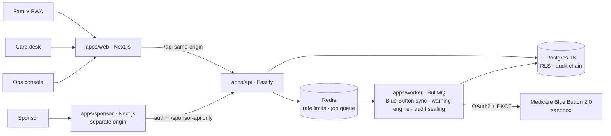

# Tomoni

**The care team between doctor visits, and a living research cohort for drug development.** Grandpa gets a short daily call in his language, his family gets one app, and his doctor gets a between-visit care program that Medicare pays for. With separate consent, the same calls build a research cohort that drug developers pay to use.

The product and business plan: [`docs/PRODUCT.md`](docs/PRODUCT.md). How it gets big: [`docs/STRATEGY.md`](docs/STRATEGY.md). The build spec: [`docs/BUILD_PROMPT.md`](docs/BUILD_PROMPT.md).

> **Status: Phases 1–5 complete** (foundation, medicines core, voice and agent, doctor desk and APCM, research core), plus the first India bridge slice. Synthetic data only. Real patient data stays off until the go-live checklist (Phase 7) is signed off. See [`docs/PROGRESS.md`](docs/PROGRESS.md).

## Run it

Prerequisites: Node 24+, pnpm 11, Docker.

```sh
pnpm install
pnpm dev:all
```

`dev:all` creates `.env` with fresh local keys, starts Postgres 18 and Redis 8 in Docker, runs the migrations, and seeds a synthetic world: 3 practices and 500 patients, whose medicines arrive through the mock Blue Button and are then checked by the warning engine. Then it starts every app and the background worker:

| Surface | URL |
| --- | --- |
| Family app, care desk, ops console | http://localhost:3000 |
| Research partner portal | http://localhost:3100 |
| API and OpenAPI docs | http://localhost:4000/docs |
| Design system (Storybook) | `pnpm --filter @tomoni/ui storybook` → http://localhost:6006 |

Other commands: `pnpm test` (unit and database tests), `pnpm --filter @tomoni/web test:e2e` (Playwright on an isolated stack), `pnpm typecheck`, `pnpm lint`, `pnpm db:reset && pnpm db:seed`, `pnpm --filter @tomoni/seed bench` (warning engine on 10,000 patients), `pnpm --filter @tomoni/seed bench:api` (k6 read latency) and `bench:web` (Lighthouse), `infra/scripts/db-backup.sh drill` (backup and restore), `pnpm infra:down`.

Operating it: [RUNBOOK](docs/RUNBOOK.md). Before real patients: [GO_LIVE_CHECKLIST](docs/GO_LIVE_CHECKLIST.md). Showing it: the [five-minute demo](docs/DEMO.md).

`TOMONI_TODAY=2026-11-15` pins "today" for the engine and the synthetic data. Tests and e2e use it, because the scripted households are written against that date.

## Demo logins

All use the password `tomoni-demo-2026`. They exist only in the synthetic seed, and the seed refuses to run when real data is enabled.

| Email | Role | Lands on | MFA |
| --- | --- | --- | --- |
| `asha@demo.tomoni.test` | Family member (Raj's daughter): sees Raj's and Kokila's medicines and warnings | Family app | No |
| `raj@demo.tomoni.test` | Patient | Family app | No |
| `priya@demo.tomoni.test` | Family member abroad (India bridge): her mother Sunita lives in Ahmedabad | Family app, with "Add a medicine" | No |
| `dr.rao@demo.tomoni.test` | Physician, Rao Family Medicine | Care desk | Yes, enroll on first sign-in |
| `nurse.priya@demo.tomoni.test` | Nurse, Rao Family Medicine | Care desk | Yes |
| `frontdesk@demo.tomoni.test` | Front desk, Rao Family Medicine | Care desk | Yes |
| `ops.kiran@demo.tomoni.test` | Ops agent, Sunrise Internal Medicine | Ops console | Yes |
| `admin@demo.tomoni.test` | Admin: PBM uploads, data file log | Admin (`/admin/data`) | Yes |
| `sponsor@demo.tomoni.test` | Sponsor user | Partner portal (:3100) only | Yes |

For MFA, scan the QR code with any authenticator app, or type the key shown under it.

**Try the call:** sign in as `nurse.priya@demo.tomoni.test`, open the desk, and click **Call simulator**. Pick Raj and start a call. Then type as Raj, for example "I'm fine", then "Mujhe chakkar aa rahe hain" (feeling dizzy). The nurse flag appears on the desk in another tab within a second. Try "chest pain" in any of the six languages.

**Try Trial Bridge:** as `raj@demo.tomoni.test`, open **Research studies** and join. As `dr.rao`, mark the study introduced on the desk. As `admin`, move Raj through **Research matches**. As `sponsor@demo.tomoni.test` on port 3100, see only rounded counts and the work billed.

**Try the agent:** as Asha, tap **Ask Tomoni to help** on a warning. Transfers wait for Asha's **Approve**; renewals wait for `dr.rao` to **Sign** on the desk.

## Architecture



- **The database enforces who sees what.** One row-level-security policy decides who can see a patient. Every request runs in a transaction scoped to the caller. The audit log is append-only and hash-chained.
- **PHI identifiers are encrypted in the app** with AES-256-GCM and a column-bound AAD before they reach Postgres.
- **The sponsor portal is a separate app on its own origin.** It can't reach the care API at all.
- **Every external system has a real adapter and a `Mock*` adapter.** A SANDBOX bar shows on every screen whenever any mock is active.

Details: [ARCHITECTURE](docs/ARCHITECTURE.md) · [DATA_MODEL](docs/DATA_MODEL.md) · [SECURITY](docs/SECURITY.md) · [DESIGN](docs/DESIGN.md) · [DECISIONS](docs/DECISIONS.md) · [ROADMAP](docs/ROADMAP.md).

## Mocked vs real

| Integration | Now | Real adapter arrives |
| --- | --- | --- |
| Telephony (calls, SMS) | Mock; the browser call simulator stands in for a phone | Built: Twilio (`TOMONI_ADAPTER_TELEPHONY=real`, needs the real-data flag) |
| Speech-to-text / text-to-speech | Twilio's built-in speech when telephony is real | Dedicated vendor: D-007 |
| Conversation LLM | `MockLLM` (keyword rules) | Built: Claude Opus 5.5 (`TOMONI_ADAPTER_LLM=real` + Anthropic credentials) |
| Pharmacy portal, e-prescribing | Mock (deterministic, labeled) | Partner to be chosen (Go-Live) |
| Medicare Blue Button 2.0 | Mock | Built: `TOMONI_ADAPTER_BLUEBUTTON=real` plus sandbox client credentials. Production also needs `TOMONI_REAL_DATA_ENABLED=true` |
| CMS plan, formulary and pricing files | Synthetic sample in the real file format | Loader built; a full CMS release needs a streaming loader (PROGRESS) |
| PBM change lists | Admin CSV upload with column mapping | Built |
| Drug shortages, pharmacy closures | Synthetic sample notices | Feeds to be chosen |
| PGx lab results | Entered by the practice on the desk | Lab interface to be chosen |
| Voice Lab speech features | `MockFeatureService` (labelled `mock-0`) | Built: `apps/ml` (`TOMONI_ADAPTER_FEATURES=real`); audio capture not built yet |
| Fax | None yet | Not planned before Go-Live |

Real adapters refuse to start unless `TOMONI_REAL_DATA_ENABLED=true`, and that flag stays off until legal sign-off.

## Repository

```
apps/      api · web (family, desk, ops, admin) · sponsor · worker
packages/  core · db · medicines · seed · contracts · ui · i18n · web-shared · config
infra/     docker-compose · postgres init · dev scripts
docs/      product plan, build spec, architecture, data model, security, design, decisions, progress
```
