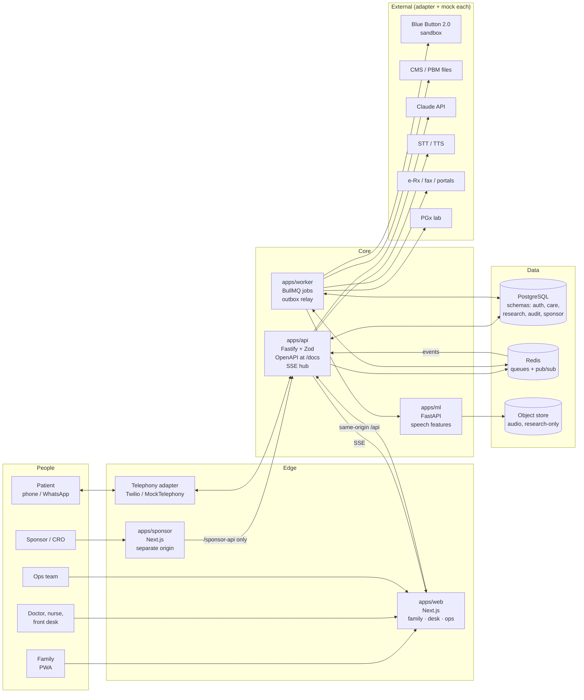

# Architecture

Status: Phase 1 design, written 2026-11-15. Changes to this doc go through `DECISIONS.md`.

## One-paragraph summary

Tomoni is a TypeScript monorepo with one API (Fastify), one job worker (BullMQ on Redis), two Next.js web apps and a Python speech-feature service. All of them sit on one PostgreSQL database.
- **PHI web app** (`apps/web`): family app, doctor desk and ops console.
- **Sponsor portal** (`apps/sponsor`): a separate app on its own origin with no PHI.
- **Speech-feature service** (`apps/ml`): Python, research pipeline only.

Safety rules live in the database (row-level security, append-only audit, consent gates) and in pure, tested domain code (`packages/core`), not only in the UI. Every external system (telephony, speech, LLM, Blue Button, e-prescribing, fax, labs) sits behind an interface with a real adapter and a `Mock*` adapter.

## System diagram



## Repository layout

```
tomoni/
├── apps/
│   ├── api/          Fastify HTTP API, auth, SSE hub, voice webhooks
│   ├── worker/       BullMQ workers: calls, warning engine, ingestion, outbox relay
│   ├── web/          Next.js PHI surfaces: /family, /desk, /ops (+ /dev/call-simulator)
│   ├── sponsor/      Next.js sponsor portal (aggregate, de-identified only)
│   └── ml/           Python FastAPI speech-feature extraction (research only)
├── packages/
│   ├── core/         Pure domain logic: warning engine, policy engine, safety
│   │                 phrase matcher, skill registry, scoring. No I/O.
│   ├── db/           Drizzle schema, SQL migrations (incl. RLS + audit), seed generator
│   ├── contracts/    Zod schemas shared by API and clients; OpenAPI generation
│   ├── integrations/ Adapter interfaces + Real*/Mock* implementations
│   ├── research/     Research-only code + the ResearchOnly<T> brand (lint-fenced)
│   ├── i18n/         ICU message catalogs (en, hi complete; gu, ta, pa, bn scaffold)
│   ├── ui/           Design system: tokens, Tailwind preset, Radix components, Storybook
│   └── config/       Shared tsconfig, ESLint (incl. custom rules), Prettier
├── infra/
│   ├── docker-compose.yml
│   └── terraform/    HIPAA-eligible skeleton, never applied from this repo
└── docs/
```

**Why `web` and `sponsor` are separate apps** (DECISIONS D-002): the sponsor portal must never be able to show PHI. A separate app on a separate origin has its own cookies and CSP, and talks only to `/sponsor-api/*`. Those routes run on a database role that can't read PHI tables. Family, desk and ops share one app because they share the same PHI and auth model, and three apps would triple the setup for no isolation gain.

## Request lifecycle (API)

1. **Edge.** The browser calls `/api/*` on the web origin. Next.js rewrites it to the API, which keeps cookies first-party.
2. **Authentication.** A session cookie (`__Host-tomoni_sid`, httpOnly, Secure, SameSite=Strict) is looked up in `auth.session`. Idle timeout is 15 minutes for clinical, sponsor and ops roles and 7 days for family. MFA (TOTP) is required for clinical, sponsor, ops and admin roles.
3. **Validation.** Every route declares Zod schemas for params, query, body and response. Anything that fails is rejected with a 400 and never reaches a handler.
4. **Rate limiting.** Redis-backed (D-015). The global limit is per session, or per IP when there is no session. Login is limited per (IP, account), with a separate per-IP cap against account spraying.
5. **Scoped transaction.** The API connects as `tomoni_app` (no BYPASSRLS). Every request runs inside one transaction (`withScope`) that first sets the caller's scope with `set_config(..., is_local => true)`: the user id, the roles, and one id list per role family (`staff_practice_ids`, `ops_practice_ids`, `household_ids`, `patient_ids`).
   RLS policies read these settings, so a handler can't see rows outside the caller's scope even if its query is wrong.
6. **Audit.** Any read or write of PHI calls `audit.append(...)` in the same transaction. If the audit insert fails, the request fails.
7. **Events.** State changes write an `outbox` row in the same transaction (the transactional outbox pattern).

## Event bus and real-time

```
handler tx ──writes──▶ care.outbox ──(worker relay, LISTEN/NOTIFY wake-up)──▶ Redis pub/sub "tomoni.events"
                                                                                │
API SSE hub ◀──subscribes───────────────────────────────────────────────────────┘
   └─▶ for each open SSE stream: authorize(event, session) ─▶ push
```

- The outbox makes events durable: if a commit happens, the event will be delivered. Events carry ids and types only, no PHI. Clients refetch through TanStack Query invalidation, so every PHI read still goes through RLS and audit.
- `LISTEN/NOTIFY` wakes the relay instantly, with a 1-second poll as a fallback. Target: under 5 seconds from a call event to the nurse flag on the desk. Expected: under 1 second.
- SSE was chosen over WebSockets (D-004). All traffic is server to client, it works through proxies, and reconnection is built in.

## Jobs (worker)

| Queue | Purpose | Idempotency key |
| --- | --- | --- |
| `outbox-relay` | Publish outbox rows to Redis | outbox row id |
| `call-schedule` | Every 5 min: enqueue calls due in each patient's time zone, outside quiet hours | `patient:date` |
| `call-run` | Place one call via the telephony adapter | call id |
| `warning-engine` | Change detector → matcher → scorer | `patient:dataVersion` |
| `ingest-bluebutton` | Pull EOB resources, map to `Fill` / `Claim` | EOB id + lastUpdated |
| `ingest-cms-files` | Load plan, formulary and pricing files, versioned | file sha256 |
| `agent-action` | Run approved skill: confirm → do → verify | action id + step |
| `speech-features` | Send research audio to ML service | speech sample id |

Every queue has exponential backoff, a maximum attempt count, and a dead-letter queue that appears on the ops console.

## Domain core (`packages/core`)

These are pure functions with no I/O. They carry the logic that must never be wrong, which is why most unit tests live here.

- **`safety`**: a multilingual phrase matcher, run *before* any LLM sees a caller's words and again on every LLM output.
  - Its classes are `emergency`, `symptom`, `medication_change`, `self_harm` and `none`.
  - It works on Unicode-normalized, transliteration-aware text, so both Devanagari and Latin-script Hindi match.
  - If it fires, the conversation state machine leaves the current task. There is no path in the state machine from a fired flag back to an admin task within the same turn.
- **`warnings`**: the change detector, matcher and `daysUntilProblem` scorer, plus the Access Score mapping (green > 60 days, amber 15–60, red < 15).
- **`policy`**: decides who must approve each skill and input. The rules are declarative and versioned:
  - money or prescription → family;
  - clinical → physician;
  - never automated: diagnosis, dosing, drug choice, symptoms.
- **`skills`**: the typed, versioned registry. Each skill has Zod input and output schemas, a `confirm`, `do` and `verify` contract, an approval class and an allowed-adapter list. The agent cannot call anything that isn't in the registry.
- **`plans`**: neutral Part D plan ranking by total yearly cost (premium + deductible + drug costs at the patient's pharmacy), with any commission shown and never used in ranking.

## Voice and conversation

```
Telephony (Twilio | MockTelephony | browser CallSimulator)
   │ audio
   ▼
STT adapter ──text──▶ safety.match() ──fired?──▶ escalate (nurse flag / emergency) ─▶ end task
                         │ no
                         ▼
               Conversation state machine (scripted steps, per locale)
                 ├─ deterministic steps: greeting + AI disclosure, meds taken? (yes/no), reminders
                 └─ LLM step (Claude): free-text understanding → structured slots only,
                    versioned system prompt in apps/api/prompts/*.md, output re-checked by safety.match()
                         │
                         ▼
               TTS adapter ──audio──▶ caller
```

- The LLM never chooses actions and never writes free text to the patient without a template. It fills typed slots (`medsTaken: boolean`, `mentionedSymptom: string | null`, …). Templates turn slots into speech.
- The research speech task is a separate step. It is reachable only when `research.active_consent(patient)` is true at call time. Its audio goes to research-only storage, and its duration is recorded separately from the APCM care time (D-009).

## Research boundary

- **Database.** Research tables live in the `research` schema. Every row-level-security (RLS) policy there requires `research.has_active_consent(patient_id)`. Withdrawing consent flips that function at once, with no cache.
- **Code.** Research code lives in `packages/research`. Values from it are typed `ResearchOnly<T>`, a branded type that can't be unwrapped outside `packages/research`. A custom ESLint rule bans importing `@tomoni/research` from `apps/web` and `apps/sponsor`.
- **Sponsor reads.** These go through `sponsor.*` SQL functions, which are `SECURITY DEFINER` and owned by a role that can read research and care data. They return only aggregates, with suppression and rounding already applied. The sponsor API's DB role is `tomoni_sponsor`, which has `EXECUTE` on those functions and nothing else.

## Integrations (`packages/integrations`)

| Interface | Real adapter | Mock adapter | Phase |
| --- | --- | --- | --- |
| `Telephony` | Twilio Voice + Messaging | `MockTelephony` (in-process, simulator UI) | 3 |
| `SpeechToText` / `TextToSpeech` | Vendor TBD (D-007) | `MockSpeech` (text passthrough) | 3 |
| `ConversationLLM` | Anthropic Claude | `MockLLM` (rule-based slot filler) | 3 |
| `BlueButton` | CMS BB2.0 sandbox OAuth + FHIR | `MockBlueButton` (Synthea-shaped EOBs) | 2 |
| `CmsFiles` | Public CMS file download | Bundled sample files | 2 |
| `ERx` / `Fax` / `PharmacyPortal` | TBD (Surescripts-certified partner) | `Mock*` | 3–4 |
| `PgxLab` | TBD certified lab | `MockPgxLab` | 6 |
| `ObjectStore` | S3-compatible | Local filesystem | 3 |

The adapter is chosen by env (`TOMONI_ADAPTER_<NAME>=real|mock`). `GET /api/system/sandbox` reports which adapters are mocks, and the shared `<SandboxBadge/>` renders on every screen whenever any mock is active. A real adapter refuses to start unless `TOMONI_REAL_DATA_ENABLED=true`. That flag is documented in `GO_LIVE_CHECKLIST.md` as needing legal sign-off.

## Environments

| Env | Data | Adapters | Notes |
| --- | --- | --- | --- |
| local | synthetic seed | all mock (BB can use sandbox) | `pnpm dev:all` |
| ci | synthetic seed | all mock | Postgres + Redis service containers |
| staging (future) | synthetic | real vendors in test mode | BAAs required before any real vendor |
| production (future) | real | real | blocked until `GO_LIVE_CHECKLIST.md` is complete |

## Local ports

Postgres `5544`, Redis `6390`, API `4000`, web `3000`, sponsor `3100`, ML `4100`, Storybook `6006`. These were chosen to avoid ports already used on the dev machine (5433, 8080).
