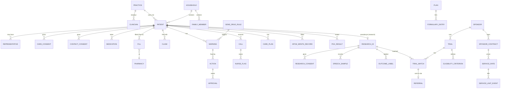

# Data model

PostgreSQL 18. There are five schemas, each with its own access rules. Drizzle defines the tables, and hand-written SQL migrations add the row-level security (RLS) policies, triggers and functions Drizzle can't express.

| Schema | Holds | Who can read |
| --- | --- | --- |
| `auth` | Accounts, identities, role grants, sessions | API only (through RLS on own rows) |
| `care` | Everything the care product needs, including PHI | `tomoni_app` and `tomoni_worker`, through RLS |
| `research` | Research consents, pseudonyms, speech samples, outcome labels, trial matches | Same roles, through RLS **plus** an active research consent |
| `audit` | Append-only, hash-chained event log | Insert through `audit.append()` only; read by admin, ops and auditors |
| `sponsor` | `SECURITY DEFINER` aggregate functions only, no tables | `tomoni_sponsor` (EXECUTE only) |

**Database roles:**
- `tomoni_owner` runs migrations.
- `tomoni_app` is used by API requests. RLS is enforced and it has no BYPASSRLS.
- `tomoni_worker` is used by jobs. RLS is enforced, and its context is `app.actor = 'system:<job>'`, with an explicit practice scope.
- `tomoni_sponsor` is used by the sponsor API and can call only `sponsor.*` functions.

**Conventions:**
- Ids are `uuid` (v7, generated in the app, so they sort by time).
- Every table has `created_at` and `updated_at` (`timestamptz`).
- Money is stored as `bigint` cents.
- Dates are `date`, timestamps are `timestamptz`, and every patient carries an IANA time zone.
- **enc** marks fields encrypted in the app with AES-256-GCM (see SECURITY.md). They're stored as `bytea` with a key id. Each searchable encrypted field has a keyed HMAC hash column (`*_hash`) for equality lookups.

## Entity map

## `auth`

| Table | Columns (key ones) | Notes |
| --- | --- | --- |
| `user_account` | id, email (citext, unique), password_hash (argon2id), mfa_secret **enc**, mfa_enabled_at, status (`active`/`locked`/`disabled`), failed_logins, locked_until | Patients often have no account; family members and staff do |
| `identity` | user_id, provider (`password`/`oidc:<issuer>`), subject | Makes the system OIDC-ready without a schema change |
| `role_grant` | user_id, role, practice_id?, household_id?, patient_id?, granted_by, granted_at, revoked_at | The scope columns say where the role applies |
| `session` | id_hash (sha256 of the token), user_id, mfa_verified_at, created_at, last_seen_at, idle_timeout_s, absolute_expires_at, ip_hmac, user_agent | The raw token is only ever in the cookie |

`role` enum: `patient`, `family_member`, `representative`, `physician`, `nurse`, `front_desk`, `ops_agent`, `sponsor_user`, `admin`.

**Scope rules:**
- Family members and representatives are scoped to a household or a patient.
- Physicians, nurses and front-desk staff are scoped to a practice.
- Ops agents are scoped to practices with `offshore_ops_access = true` (see D-008).
- Sponsor users are scoped to a sponsor. They have no PHI role at all.
- Admins are global, and every admin read is audited.

## `care`

### People and organizations

| Table | Columns | Notes |
| --- | --- | --- |
| `practice` | id, name, npi, tz, address, phone, apcm_enrolled_at, offshore_ops_access (bool, default **false**) | |
| `clinician` | id, practice_id, user_id?, npi?, kind (`physician`/`nurse`/`front_desk`), display_name | There is **no money or payout column, by design** (rule 2.7) |
| `household` | id, display_name, primary_locale | |
| `patient` | id, practice_id, household_id, mbi **enc**, mbi_hash, name **enc**, dob **enc**, birth_year (for age criteria), phone **enc**, phone_hash, address **enc**, state, locale, tz, call_window_start, call_window_end, medicare_type (`original`/`advantage`), status (`active`/`paused`/`deceased`/`left`) | `birth_year` and `state` stay unencrypted so matching works; both count as identifiers under HIPAA de-identification, so exports generalize them |
| `family_member` | id, household_id, user_id?, display_name, relationship, phone **enc**, phone_hash, notify_on_emergency (bool) | |
| `representative` | id, patient_id, family_member_id? or external_name **enc**, legal_basis (`healthcare_poa`/`guardian`/`state_surrogate`), document_ref, verified_by, valid_from, valid_to | Rule 2.6 |

### Consents (care)

| Table | Columns | Notes |
| --- | --- | --- |
| `care_consent` | id, patient_id, practice_id, program (`apcm`), given_by_kind (`patient`/`representative`), given_by_id, method (`verbal_recorded`/`written`/`e_sign`), copay_disclosed (bool, required true), given_at, withdrawn_at, withdrawal_recorded_by, evidence_ref | APCM requires documented consent and a co-pay disclosure |
| `contact_consent` | id, patient_id, channel (`voice`/`sms`/`whatsapp`), phone_hash, recording_allowed (bool), quiet_hours (int4range per weekday), given_by_kind, given_by_id, given_at, withdrawn_at | Calls go only to numbers with an active row (rule 2.10, TCPA) |

### Medicines and coverage

Reference data (public files, not PHI) is readable by any signed-in request and written by the worker or an admin upload. Patient data follows the patient policy.

| Table | Columns | Notes |
| --- | --- | --- |
| `medication` | id, patient_id, rxcui, display_name, sig_text **enc**, prescriber_clinician_id?, active, source (`claims`/`desk`/`family`/`call`) | One per (patient, rxcui) |
| `fill` | id, patient_id, medication_id?, ndc, rxcui?, fill_date, days_supply, quantity, fill_number?, refills_remaining?, pharmacy_id?, patient_paid_cents?, source (`bluebutton`/`mock`/`manual`), source_ref (EOB id), ingested_at | `UNIQUE(source, source_ref)` keeps ingestion idempotent. `refills_remaining` is null unless the EOB carries `refillsAuthorized` (D-018) |
| `claim` | id, patient_id, kind (`inpatient`/`outpatient`/`carrier`/`snf`/`hha`/`hospice`), start_date, end_date, dx_codes (text[]), source, source_ref | Supplies the Voice Lab outcome labels |
| `bluebutton_link` | patient_id, mode (`sandbox`/`mock`/`production`), fhir_patient_id **enc**, access_token **enc**, refresh_token **enc**, expires_at, scope, connected_by, connected_at, last_synced_at, revoked_at | Inserted by the patient or their household only (they sign in to Medicare.gov themselves) |
| `data_file_version` | id, kind (`cms_partd`/`pbm_changes`/`shortage`/`pharmacy_closure`), label, source_url, sha256 (unique), effective_date, row_count, dropped_count, loaded_by, loaded_at | Every file-based warning cites one. A CMS release (plan, formulary and pricing files published together) is one version |
| `drug` | ndc (PK), rxcui, name | NDC → RxCUI for claims; names from the drug list (CMS files carry none) |
| `pharmacy` | id, npi (unique), name, address, phone | |
| `plan` | id, version_id, year, contract_id, plan_id, segment_id, name, type (`pdp`/`mapd`), premium_cents, deductible_cents, formulary_id | |
| `formulary_entry` | version_id, formulary_id, rxcui, tier, prior_auth, step_therapy, quantity_limit | One row per RxCUI; the CMS file lists every NDC |
| `drug_price` | version_id, contract_id, plan_id, segment_id, rxcui, days_supply (30/60/90), unit_cost | As published: dollars per unit, per plan |
| `formulary_change` | version_id, formulary_id, rxcui, change (`removal`/`tier_change`), new_tier?, effective_date | PBM change lists (admin upload with column mapping) |
| `drug_shortage` | version_id, rxcui, reported_on, resolved_on? | |
| `pharmacy_closure` | version_id, pharmacy_id, closes_on | |
| `patient_plan` | patient_id, year, contract_id, plan_id, segment_id | Keyed by the CMS plan ids, which outlive any one file version |
| `plan_offer` | id, patient_id, year, plan_id, total_yearly_cost_cents, rank, commission_cents_to_partner?, computed_at, inputs_hash | Phase 3 (`comparePartDPlans`). Ranked by cost only; commission is shown and never used to rank (rule 2.11) |

### Warnings, actions, approvals

| Table | Columns | Notes |
| --- | --- | --- |
| `warning` | id, patient_id, medication_id?, type, status, days_until_problem, problem_date, access_status (`green`/`amber`/`red`), source_kind (`fill`/`data_file`/`call`/`pgx`), source_ref, source_date, evidence (jsonb), dedupe_key (unique while open), created_at, resolved_at, outcome (`happened`/`prevented`/`false_alarm`/`unknown`) | `outcome` measures the hit rate the plan promises to publish |
| `action` | id, patient_id, warning_id?, skill, skill_version, inputs (jsonb, schema-checked), approval_class (`none`/`family`/`physician`), state, confirm_result, do_result, verify_result, attempts, next_attempt_at, handoff_reason?, idempotency_key (unique) | The `state` machine is defined in `packages/core/policy` |
| `approval` | id, action_id, approver_user_id, approver_role, decision (`approve`/`reject`), reason?, decided_at | A database trigger checks that the approver's role matches the action's `approval_class` |

`warning.type` enum: `run_out`, `late_refill`, `premium_jump`, `formulary_removal`, `tier_change`, `negotiated_price_change`, `pharmacy_closure`, `shortage`, `gene_drug_mismatch`.

`action.state`: `proposed → awaiting_approval → approved → running → verifying → succeeded`. It can also end at `rejected`, `failed`, `handoff` or `cancelled`.

### Calls, flags, care plans, billing

| Table | Columns | Notes |
| --- | --- | --- |
| `call` | id, patient_id, direction, channel, scheduled_for, started_at, ended_at, locale, script_version, prompt_version, outcome (`completed`/`no_answer`/`voicemail`/`failed`/`escalated`), disclosure_played (bool), recording_consent (bool), transcript **enc**, summary **enc**, care_seconds, research_seconds, telephony_ref | `care_seconds` and `research_seconds` are kept apart so research time never counts as APCM care time (D-009) |
| `nurse_flag` | id, patient_id, call_id?, channel, class (`emergency`/`symptom`/`medication_change`/`self_harm`), matched_rule, excerpt **enc**, urgency (1–3), status (`open`/`acknowledged`/`resolved`), assigned_to?, acknowledged_at, resolved_at, resolution_note **enc** | |
| `care_plan` | id, patient_id, version, status (`draft`/`signed`/`superseded`), body (jsonb: problems, goals, medications, interventions, contacts), drafted_by (`agent`/user id), signed_by?, signed_at? | Signed versions are immutable (enforced by a trigger) |
| `apcm_month_record` | id, patient_id, practice_id, month, hcpcs (`G0556`/`G0557`/`G0558`), consent_id, care_plan_id, services (jsonb list of {kind, at, ref}), status (`draft`/`ready`/`billed`/`excluded`), exclusion_reason? | Lists only services actually delivered, each with a link to its evidence |
| `pgx_result` | id, patient_id, gene, diplotype, phenotype, lab, reported_at, ordered_by_clinician_id, source_ref | This is clinical data in `care`, not research |
| `gene_drug_rule` | id, gene, phenotype, rxcui, recommendation_code, cpic_level, source_url, version | Reference data, seeded with a few CPIC level-A pairs |
| `invite` | id, household_id, kind (`sibling`/`doctor`), target **enc**, token_hash, status, expires_at | |
| `outbox` | id (bigserial), topic, aggregate_type, aggregate_id, payload (jsonb, **no PHI**), created_at, published_at? | Transactional outbox |

## `research`

**Every policy in this schema requires `research.has_active_consent(patient_id)`.** That function returns true only when a `research_consent` row exists with `withdrawn_at IS NULL`, for a protocol whose status is `approved` and not yet expired. Withdrawing consent takes effect on the next statement, because the function is evaluated live with no cache.

| Table | Columns | Notes |
| --- | --- | --- |
| `protocol` | id, code, version, irb_name, irb_approval_ref, approved_at, expires_at, status (`draft`/`approved`/`suspended`/`closed`), plain_summary (jsonb by locale) | |
| `research_id` | patient_id (unique), research_pid (random uuid) | The pseudonym. Only this table maps it to a patient |
| `research_consent` | id, patient_id, protocol_id, given_by_kind, given_by_id, hipaa_authorization_ref, recording_permission, scope_speech_task, scope_trial_matching, scope_pgx_research, method, given_at, withdrawn_at, withdrawal_recorded_by | Each scope is a separate opt-in |
| `speech_sample` | id, research_pid, consent_id, task_code, task_version, locale, recorded_at, duration_ms, audio_ref, features (jsonb, `ResearchOnly`), feature_version | Audio goes to a research-only bucket prefix |
| `outcome_label` | id, research_pid, kind (`inpatient_stay`/`ed_visit`/`new_dx`), start_date, source_claim_id | Derived from `care.claim` by a worker job running as the research role |
| `sponsor` | id, name, kind (`pharma`/`cro`) | |
| `trial` | id, sponsor_id, nct_id, title, therapeutic_area, status, protocol_ref | |
| `eligibility_criterion` | id, trial_id, include (bool), field (`age`/`condition_icd`/`drug_rxcui`/`recent_inpatient_days`/`locale`/`state`/`medicare_type`), operator, value (jsonb) | Fields are a closed enum, so the matcher can't be asked arbitrary questions |
| `trial_match` | id, trial_id, research_pid, stage, stage_at (jsonb of timestamps), intro_clinician_id?, declined_reason? | Stages: `matched` → `prescreened` → `introduced` → `consent_prep` → `consented` → `randomized` → `retained`, or `declined` / `withdrawn` |
| `referral` | id, trial_match_id, site_ref, sent_at, status | |
| `sponsor_contract` | id, sponsor_id, trial_id?, effective_from, effective_to, status, signed_ref | |
| `service_rate` | id, contract_id, unit, rate_cents, fmv_basis_ref (required), set_by_admin_id | `unit` enum: `feasibility_report`, `prescreen_completed`, `introduction_delivered`, `consent_prep_call`, `retention_participant_month`, `study_hours`. **`randomized_participant` is not in the enum** (D-010) |
| `service_unit_event` | id, rate_id, trial_match_id?, quantity, occurred_at, invoice_id? | |
| `invoice` | id, contract_id, period_start, period_end, total_cents, status | |

**No finder's fees (rule 2.7).** Payments only flow sponsor → Tomoni, through `service_rate`. Two things enforce this:
1. No table has a column linking a clinician to money.
2. A schema test, `packages/db/test/no-finders-fee.test.ts`, fails if any column whose name matches `payout|commission|bounty|finder|referral_fee|incentive` sits in a table that references `care.clinician`. It also fails if `service_rate.unit` ever gains a value tied to a clinician.

## `audit`

| Column | Type | Notes |
| --- | --- | --- |
| id | bigserial | |
| at | timestamptz | `clock_timestamp()` |
| actor_kind | `user` / `system` / `agent` | |
| actor_id | text | user id, `system:<job>` or `agent:<skill>@<version>` |
| actor_roles | text[] | |
| action | `read` / `create` / `update` / `delete` / `export` / `consent_change` / `login` / `login_failed` / `agent_action` / `approval` | |
| entity_type, entity_id | text, uuid | |
| patient_id | uuid? | Lets "who looked at my dad's data" be answered |
| purpose | text | `treatment` / `operations` / `payment` / `research` / `support` |
| details | jsonb | **No PHI.** Ids and field names only |
| prev_hash, hash | bytea | `hash = sha256(prev_hash ‖ canonical_json(row without hash))` |

- **Append-only.** `UPDATE`, `DELETE` and `TRUNCATE` are revoked from every role, and a trigger raises on update or delete as a second guard.
- **Single entry point.** `audit.append()` is `SECURITY DEFINER`. It takes `pg_advisory_xact_lock` to keep the chain linear. (Ponytail: one global chain. Split it per practice if write throughput ever matters.)
- **Verification.** `audit.verify(from_id, to_id)` recomputes the chain and returns the first broken link.

## `sponsor` (functions only)

| Function | Returns |
| --- | --- |
| `sponsor.feasibility(trial_id)` | Counts of consented registry members matching each criterion and all criteria together, broken down by coarse bands (age band, state region, locale) |
| `sponsor.funnel(trial_id)` | Counts per `trial_match.stage` |
| `sponsor.usage(contract_id, period)` | Service units and invoice lines |

All three apply the same disclosure control before returning:
- **Primary suppression:** any count from 1 to 10 becomes `NULL` with `suppressed = true`.
- **Secondary suppression:** a total that would let someone subtract back to a suppressed cell is also suppressed.
- **Rounding:** non-suppressed counts are rounded to the nearest 5.

Every function also checks that the caller's sponsor owns the trial or contract, and logs an `audit` `export` event. See SECURITY.md for how differencing attacks are handled.

## Synthetic seed

The seed (`packages/db/seed`) is deterministic (seeded PRNG) and loads:
- **3 practices and 500 patients**, with 20 households containing named, scripted families. One of them is Raj (73, Gujarati) and his daughter Asha, matching the plan's illustrative week.
- **Regimens** from a fixed list of common chronic-disease drugs, with realistic fill cadences and planted problems (run-outs, a tier change, a formulary removal, CYP2C19 poor-metabolizer status on clopidogrel).
- **Locales:** en, hi, gu, ta, pa, bn.

There is one login per role. The README lists them, and every one only works when `NODE_ENV !== 'production'`.
