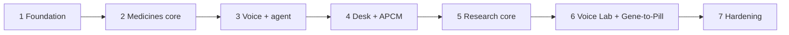

# Build roadmap

The phases follow `BUILD_PROMPT.md` §9. A phase starts only after the previous phase's Definition of Done is met and recorded in `PROGRESS.md`. Each slice is end to end (DB → API → worker → UI → tests → seed → docs) and gets one commit.

## Phase 1: Foundation

| Slice | Contents |
| --- | --- |
| 1.1 Monorepo | pnpm workspaces, Turborepo, strict TS config, ESLint (incl. `tomoni/*` custom rules), Prettier, Vitest, GitHub Actions CI |
| 1.2 Local infra | `infra/docker-compose.yml` (Postgres 18, Redis 8), `.env.example`, `pnpm dev:all` |
| 1.3 Database core | DB roles, schemas, Drizzle schema for `auth` and the care people/consent tables, RLS policies, `audit.append` / `audit.verify`, outbox, app-level field encryption |
| 1.4 Auth and roles | Login, argon2id, TOTP MFA, sessions with idle/absolute timeouts, CSRF, rate limits, role scopes → RLS context, `/api/me`, OpenAPI at `/docs` |
| 1.5 UI foundation | `@tomoni/ui` tokens (light/dark), core components, Storybook; `@tomoni/i18n` (en, hi complete; gu/ta/pa/bn scaffold; RTL-ready); web app shell for family, desk and ops; sponsor app shell; `SandboxBadge` |
| 1.6 Seed and logins | Deterministic synthetic generator (3 practices, 500 patients, 20 scripted households incl. Raj and Asha); one login per role; Playwright login test per role |

**Done when:** `pnpm dev:all` starts everything, CI is green, and the role/RLS tests pass.

## Phase 2: Medicines core
Slices: Blue Button sandbox OAuth and EOB → `fill`/`claim` · CMS file loaders (bundled samples) and PBM CSV mapping · warning engine (change detector, matcher, scorer) · family card with Access Scores and evidence links.
**Done when:** seeded households show correct, sourced warnings and the e2e tests pass.

## Phase 3: Voice and agent
Slices: contact consent and call scheduler (time zones, quiet hours) · safety matcher for every shipped locale · conversation state machine plus Claude slot-filling (versioned prompts, eval tests) · call simulator page · nurse flags over SSE · skill registry, policy engine, approvals, retries, ops handoff.
**Done when:** a simulated call with a symptom puts a nurse flag on the desk live in under 5 seconds, and the emergency-phrase tests pass in every shipped language.

## Phase 4: Doctor desk and APCM
Slices: keyboard-first queue with evidence panes and bulk sign · care-plan drafts and signing · APCM month records and evidence export · practice report · family activity log, streaks and invites.
**Done when:** the "one week in Tomoni" scenario runs end to end in Playwright.

## Phase 5: Research core
Slices: protocols and research eConsent (per locale, representatives) · pseudonyms and gating · Trial Bridge (criteria editor, matcher, pre-screen script, doctor intro card, referral tracker) · sponsor portal (feasibility, funnel, usage) with disclosure control.
**Done when:** the consent-gating, small-cell suppression and no-finder's-fee tests pass, and the referral funnel works end to end.

## Phase 6: Voice Lab and Gene-to-Pill
Slices: research speech task in the call · ML feature service and contract · outcome labeling from claims · PGx upload, CPIC rules, gene-drug warnings (doctor only).
**Done when:** the `ResearchOnly` boundary is proven by tests, and the clopidogrel/CYP2C19 scenario raises a doctor-only warning.

## Phase 7: Hardening
Load tests (k6) against §6 targets · security checklist · axe and Lighthouse fixes · OpenTelemetry dashboards · backup/restore drill · RUNBOOK, GO_LIVE_CHECKLIST, demo script.
**Done when:** every target in §6–8 is measured and met, and `PROGRESS.md` lists the remaining gaps honestly.
